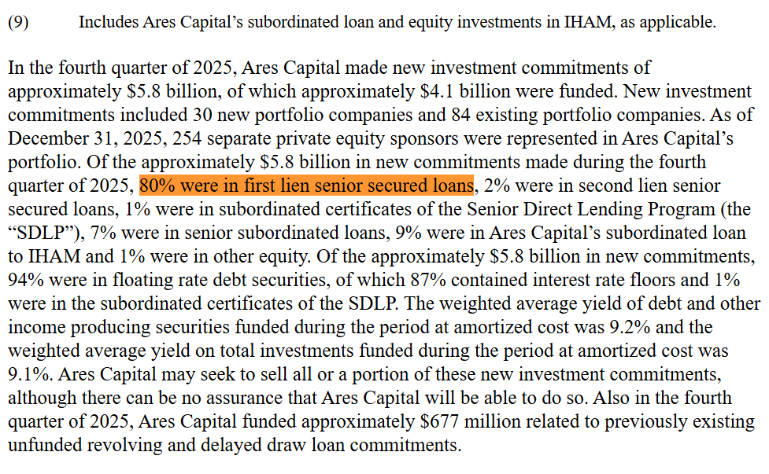

# Local RAG over SEC Filings

A local LLM answering questions about a private credit lender's SEC filing, with citations back to the exact text it used. Everything runs on my own machine: no API calls, and the document never leaves my computer.

**Result:** asked what share of Ares Capital's Q4 2025 new commitments were first lien senior secured loans, the model answered **80%**, cited the right source chunk, and quoted the supporting sentence word for word. Without the document, the same model couldn't answer at all.

**Stack:** Gemma 4 12B (4-bit) in Ollama · FastEmbed (bge-small-en-v1.5) · ChromaDB · LangChain · BeautifulSoup

**Hardware:** NVIDIA RTX 4060 Ti (16 GB VRAM), Intel i5-10600K

---
# Goal
Running a large language model locally has some advantages, specifically privacy and cost. One significant drawback is that it's limited to the information it was trained on. My goal in this example is to show how we can use retrieval-augmented generation (RAG) to let a local LLM answer questions from a document, with citations.

For this example we will be using Ares Capital's Q4 2025 earnings press release, filed with the SEC on February 4, 2026 (Form 8-K, Exhibit 99.1): [https://www.sec.gov/Archives/edgar/data/1287750/000128775026000004/arccq4-2025exhibit991.htm](https://www.sec.gov/Archives/edgar/data/1287750/000128775026000004/arccq4-2025exhibit991.htm)

Everything in this example was run locally on my hardware.

---

# Step 1: Set up a locally running LLM

For this example I'm using Gemma 4 12B (`gemma4:12b-it-qat`, 4-bit quantized) running in Ollama [https://ollama.com](https://ollama.com/). Once Ollama is installed, download the model:

```
ollama pull gemma4:12b-it-qat
```

Then install the Python libraries:

```
pip install beautifulsoup4 tqdm langchain-core langchain-community langchain-chroma langchain-ollama fastembed
```

Save the press release from the link above into the project folder as `Document.html` 

The full script is in [`doc_analyze.py`](doc_analyze.py). The steps below walk through each part of it.

---

# Step 2: Ask the model without the document

```python
from langchain_ollama import OllamaLLM

question = ("What percentage of Ares Capital's new investment commitments in the "
            "fourth quarter of 2025 were first lien senior secured loans?")
print(OllamaLLM(model="gemma4:12b-it-qat").invoke(question))
```

There is no way that gemma4 could know the answer since its training cut off date was before that:

```
I cannot provide that information because the fourth quarter of 2025 has not happened yet.

Financial reports and investment commitment percentages for Q4 2025 will not be available until that time period concludes and the company releases its official filings (typically in early 2026).
```

---

# Step 3: Split the document into chunks

Working with a locally running LLM gives us a small context size compared to using hosted LLMs such as Claude, Gemini and Chatgpt. To make the most out of this small context size, instead of feeding the whole document to the LLM at once we will instead use retrieval-augmented generation (RAG). We split the document into small chunks and store them in a searchable database. When a question comes in, we search for the handful of chunks most related to it and give the LLM only those, along with the question.

The code below breaks the document down based on tables and divs into sections of text each containing about 1500 characters (with some overlap between each chunk in order to preserve context)

```python
def load_chunks(path):
    soup = BeautifulSoup(open(path, "rb"), "html.parser")
    blocks = [el.get_text(" ", strip=True) for el in soup.find_all(["div", "tr"]) if not el.find(["div", "tr"])]
    blocks = [b for b in blocks if b]

    chunks, current, first = [], [], 0
    for i, block in enumerate(blocks):
        current.append(block)
        if sum(map(len, current)) >= CHUNK_CHARS or i == len(blocks) - 1:
            chunks.append(Document(page_content="\n".join(current),
                                   metadata={"first_block": first, "last_block": i}))
            current, first = [block], i
    return chunks
```

The press release becomes 21 chunks.

---

# Step 4: Store the chunks in a vector database

To search the chunks by meaning instead of exact words, we use an embedding model. It turns each chunk into a list of numbers (a vector), and chunks about similar topics end up with similar vectors. For this example I'm using FastEmbed's default model, BAAI bge-small-en-v1.5. It's small enough to run locally on the CPU.

The vectors get saved to a ChromaDB database on disk, so the document wont need to be processed on every run.

```python
embeddings = FastEmbedEmbeddings()

if os.path.exists(DONE_MARKER):
    db = Chroma(persist_directory=DB_DIR, embedding_function=embeddings)
else:
    shutil.rmtree(DB_DIR, ignore_errors=True)
    chunks = load_chunks(DOCUMENT_PATH)
    db = Chroma(persist_directory=DB_DIR, embedding_function=embeddings)
    for i in tqdm(range(0, len(chunks), BATCH), desc="Embedding"):
        db.add_documents(chunks[i:i + BATCH])
    open(DONE_MARKER, "w").close()
```

For this document it only takes about 3 seconds on my hardware ( CPU: Intel i5-10600K ).

---

# Step 5: Search the database and ask the question

Now we turn the question into a vector the same way and ask ChromaDB for the 6 closest chunks. Those chunks get numbered and added to the prompt. The prompt tells the model to only use that context, cite which source each fact came from and quote the text, so we can check the answer ourselves.

```python
docs = db.similarity_search(QUESTION, k=TOP_K)
context = "\n\n".join(f"[Source {i+1}]\n{d.page_content}" for i, d in enumerate(docs))

prompt = ChatPromptTemplate.from_template(
    "Answer using only the context below. Cite sources like [Source 2] and quote the supporting text. "
    "If the answer is not in the context, say so.\n\nContext:\n{context}\n\nQuestion: {question}"
)
chain = prompt | OllamaLLM(model="gemma4:12b-it-qat", num_ctx=8192) | StrOutputParser()
print(chain.invoke({"context": context, "question": QUESTION}))
```


Result:
```
QUESTION: What percentage of Ares Capital's new investment commitments in the fourth quarter of 2025 were first lien senior secured loans?

--- ANSWER ---
In the fourth quarter of 2025, 80% of Ares Capital's new investment commitments were first lien senior secured loans.
```

Full Output (only 2 of the 6 sources shown):

```
QUESTION: What percentage of Ares Capital's new investment commitments in the fourth quarter of 2025 were first lien senior secured loans?

--- SOURCES ---

[Source 1 | blocks 67-68]
In the fourth quarter of 2025, Ares Capital made new investment commitments of approximately $5.8 billion, of which approximately $4.1 billion were funded. ...

[Source 3 | blocks 81-82]
From January 1, 2026 through January 29, 2026, Ares Capital made new investment commitments of approximately $1.4 billion, ... 90% were in f...

--- ANSWER ---
In the fourth quarter of 2025, 80% of Ares Capital's new investment commitments were first lien senior secured loans.

[Source 1] "Of the approximately $5.8 billion in new commitments made during the fourth quarter of 2025, 80% were in first lien senior secured loans, 2% were in second lien senior secured loans, 1% were in subordinated certificates of the Senior Direct Lending Program (the “SDLP”), 7% were in senior subordinated loans, 9% were in Ares Capital’s subordinated loan to IHAM and 1% were in other equity."
```

The answer is correct and the quote matches the press release word for word. Source 3 has a similar number (90% first lien), but it's for January 2026, and the model correctly ignored it.

Here's the same sentence in the original press release:



---

# Conclusion

RAG can be used as a free and private way to let a locally running LLM answer questions about documents it was never trained on, with sources you can check.
